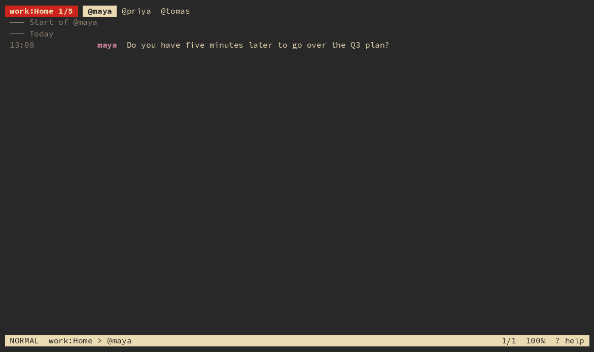

# matrix-tui

matrix-tui (`mx`) is a keyboard-driven terminal client for Matrix. Several accounts and spaces side by side, live messages, unread and mentions, a channel finder, your own editor for writing, and your own programs for opening links and attachments.



## Installation

### Nix

```sh
nix profile install github:paulchambaz/matrix-tui
```

Or add `github:paulchambaz/matrix-tui` as an input of your flake and install its `packages.default`. The man page is installed with it.

### Cargo

```sh
cargo install mx-tui
```

This installs the `mx` command.

### Manual

See the [**Building**](#building) section.

## Usage

Start `mx`, then type `:new-server`. It asks for a name, the address of your homeserver, your login and your password, and logs you in. Add as many servers as you like.

The channels of the current team are tabs along the top, the conversation is below, and the bottom line shows where you are. Keys are single letters:

| Key | Action |
| --- | --- |
| `j` `k` | next / previous message |
| `J` `K` | next / previous channel |
| `H` `L` | previous / next team, across servers |
| `f` | find a channel by typing part of its name |
| `n` `N` | next unread message / next mention |
| `i` | write a message, `enter` sends |
| `ctrl-g` | write it in your editor instead |
| `r` `e` `d` | reply to, edit, delete the selected message |
| `x` | react to the selected message |
| `o` | open the links and attachments of the selected message |
| `y` | copy the selected message |
| `?` | the full list of keys |
| `q` | quit |

Press `:` for commands such as `:server`, `:go`, `:dm` or `:status`. Everything is detailed in the [`man`](./mx.1.scd) page (`man mx` once installed).

Your servers are kept in `~/.config/mx/servers.toml`, readable only by you, password included so the session can be renewed. If you would rather not keep a password in a file, `servers.toml` can instead name a command that prints it, such as `password_cmd = "pass show work/matrix"`. For a server that signs in through the browser, add `method = "sso"` (or `method = "oidc"` for OAuth 2.0 servers) and no login or password. Two accounts on one server are two entries with different names. See the man page.

`:upload path` sends a file or an image to the open channel.

`:search text` lists the matching messages of the room: `j` and `k` move, `enter` opens the hit in place. Teams are spaces: `:space new name` creates one, `:space add name` puts the open room in it and `:space remove` takes it out.

Encrypted rooms work. The session and the keys of each server are kept in `~/.local/share/mx/`. To read messages from before this device existed, type `:recover` followed by your recovery key. To verify this session from another one, type `:verify` and compare the emojis; `:verify` followed by a user does the same with that person. `:recovery` creates a recovery key, `:sessions` and `:logout` manage your devices, `:password` and `:deactivate` change or close the account.

### Command line

With a command, `mx` prints to the standard output and exits, so a script or an AI agent can read your messages. The commands are read-only: nothing is posted and nothing is marked as read.

```sh
mx server list
mx channel list -k dm unread
mx message list dm and unread or mention and unread
mx message list -s work -c @alice after 1h
mx message list -n 0 --json from me | jq -r '.[].text'
```

`-s`, `-t`, `-k` and `-c` narrow the servers, teams, kinds of channel and channels. What follows is a query of clauses joined by `and`, and groups of them by `or` (which binds looser): `from`, `mention`, `dm`, `unread`, `after`, `before`, `body` and `thread`, each possibly after `not`. `--json` prints an array. See `mx message list -h` and the man page.

## Configuration

Everything is optional. Settings go in `~/.config/mx/config.toml`:

```toml
editor = "nvim"
copy = "xclip -selection clipboard"
notify = 'notify-send "$1" "$2"'

[open]
image = "nsxiv"
video = "mpv"
browser = "firefox"
text = "nvim -R"
other = "xdg-open"
```

- `editor` is the program `ctrl-g` starts. Without it `$EDITOR` is used, then `vi`.
- `copy` is the command that receives the text copied with `y`. Without it `mx` uses `wl-copy`, `xclip` or `xsel` if one is installed.
- `notify` is run when a message calls you, or arrives in a direct message or group that is not muted, with the room in `$1` and the text in `$2`. Without it nothing rings.
- `[open]` says which program `o` starts: `browser` for links, `image`, `video` for video and audio, `text` for text and source files, `other` for the rest. Each defaults to `xdg-open`. `text` runs inside `mx`, so it should be a terminal program.

Set `NO_COLOR` to use `mx` without colors.

## Building

### Nix

```sh
git clone https://github.com/paulchambaz/matrix-tui.git
cd matrix-tui
nix develop # a shell with every dev tool
nix build
just --list # the dev commands
```

### Manual

You need `cargo`, `scdoc` for the man page and `just` for the dev commands.

```sh
just build
just test
just lint
just install # binary and man page in ~/.local
just demo # try mx on made-up data, no server needed
```

## Contribution

Contributions are welcome: feature suggestions, bug reports or code, through issues and pull requests on GitHub.

## License

<a href="https://www.gnu.org/licenses/gpl-3.0.en.html">
  
</a>

matrix-tui is free software. You can use, study, modify and distribute it under the
terms of the [GNU General Public License](https://www.gnu.org/licenses/gpl-3.0.en.html),
version 3.
